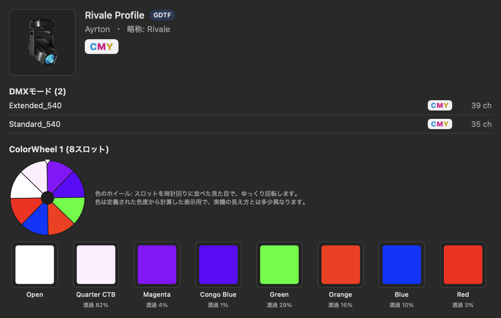
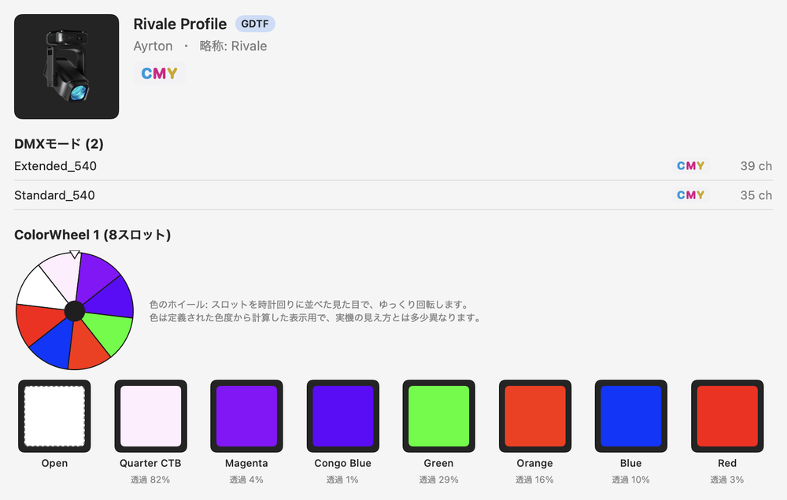
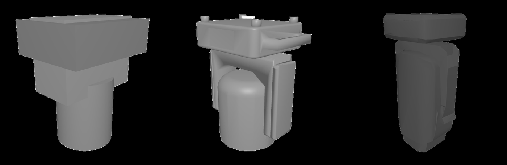
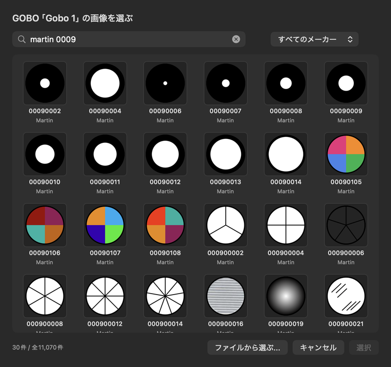

# Resource Manager for grandMA

grandMA3 / grandMA2 のファイルに素早くアクセスし、管理するための Mac アプリです。ローカル onPC・USBメモリ・実機コンソール/他のonPC(SFTP)を横断して Shows / Macros / Presets などのフォルダに一発でジャンプし、ドラッグ&ドロップでインポート/エクスポートできます。

**grandMA3 / grandMA2 のデータが入ったUSBメモリを挿すだけで自動検出**され、「Sourceとして追加しますか？」と聞かれるので、毎回手動でボリュームを探す必要がありません。

> **Note:** 実機コンソールへのSFTP接続機能は実装済みですが、実機での動作検証がまだできていません。確認でき次第このREADMEで報告します。ローカル onPC / USBメモリでの利用は動作確認済みです。

## 注目ポイント

### 機材の中身が、開かなくてもひと目でわかる
GDTF / grandMA3 XML を1クリックすると、機材の画像・メーカー・DMXモード・色ホイール・色見本が表示されます。**RGB / CMY のどちらで混色する機材か**もモードごとに表示。色ホイールはゆっくり回転します。ダーク/ライトはmacOSの設定に自動で追従します。

| ダーク | ライト |
|---|---|
|  |  |

### GDTFを3Dでプレビュー
GDTFに入っている3Dモデル(`.glb` / `.3ds`)や基本形状から機材を組み立て、ドラッグで回転・スクロールでズームできます(「3D」タブ)。



### GOBOを、デフォルトの1万枚から検索して選べる
GOBOスロットの画像は、grandMA3に入っているデフォルトGOBO(約1.1万枚)から、名前やメーカーで検索して選べます。もちろん手持ちの画像ファイルも使えます。**変更は「コピーとして保存」するまで反映されず、元のファイルは変更しません。**



## 主な機能

**ファイル管理**
- USBメモリを挿すだけで自動検出、ワンクリックでSourceとして追加
- ローカル onPC(`~/MALightingTechnology`)・USBメモリ・SFTPを横断してファイル管理
- Shows / Macros / Sequences / Presets など grandMA3 のフォルダ構成をワンクリックでナビゲート(共有ライブラリ `gma3_library` も単独のSourceとして追加可能)
- Source間のドラッグ&ドロップ(SFTP含む)、Finderからのインポート。同名ファイルがあれば上書き確認
- ファイルのリネーム・削除(確認ダイアログ、ゴミ箱送り)
- クイックオープン検索(全Source横断)、フィクスチャライブラリのメーカー名フィルタ
- 設定(⌘,)や左のカテゴリ一覧から、表示するカテゴリをチェックで選択

**プレビューとエディター(ファイルを1つクリックすると下半分に開きます)**
- 画像のプレビュー、画像の差し替え(元のファイルはゴミ箱へ)、動画(mp4 / webm)の再生
- フィクスチャー(GDTF / grandMA3 XML)の中身の表示: 機材画像、DMXモード(RGB / CMY 表示つき)、色ホイール(ゆっくり回転)、GOBO(画像付き)、プリズム
- GDTFの3Dプレビュー(3Dタブ。`.glb` / `.3ds` と基本形状に対応)
- DMXチャンネル表の編集(DMX Break / Coarse / Fine / Ultra / Default / Highlight / Lowlight / Snap)、GOBO画像の差し替え(デフォルトGOBOからの検索選択、または画像ファイル)。**編集は「コピーとして保存」するまで反映されず、元のファイルは変更せず `… custom v1` という別ファイルとして保存します**
- grandMA2 の `.pxml`(暗号化されています)から、GDTF Share で同じ機種のGDTFを検索し、ダウンロードしたGDTFをライブラリに追加

**その他**
- **USBにバックアップ**: Sourceを右クリックして、`YYMMDD-MAbackup` フォルダにMAのファイルをそのままコピー(ライブラリ一式、またはショーファイルのみ。アプリ本体は含みません)。進捗表示つき
- **MA3 onPCを起動**: 2.5以降のバージョンのSourceを右クリックして、対応するonPCアプリを起動
- 日本語対応のメニューバー、ダーク/ライトの自動切り替え

## ダウンロードしてすぐ使う

インストーラ不要、Xcode不要です。[Releases](../../releases) から `ResourceManagerForGrandMA-macOS-v5.zip` をダウンロードしてください。

1. zipを展開
2. `Resource Manager for grandMA.app` を `/Applications` に入れて起動

未署名アプリのため、初回起動時にmacOSの警告でブロックされます。

1. まず `Resource Manager for grandMA.app` を**右クリック(またはControl+クリック)→「開く」**を試す
2. 「開く」ボタンが出るダイアログならそのまま「開く」で起動完了
3. それでも「破損している」「開けません」としか出ず「開く」の選択肢が無い場合は、**「システム設定」→「プライバシーとセキュリティ」**を開き、一番下までスクロールすると「"Resource Manager for grandMA" はブロックされました」といった表示があるので、その横の**「このまま開く」**をクリック → パスワードやTouch IDで確認
4. 再度アプリを起動すると、今度は普通に開けます

一度許可すれば、2回目以降は警告なしで起動します。

対応OS: macOS 14 (Sonoma) 以降。

## ソースからビルドする

```bash
brew install xcodegen
cd "resource-manager-for-grandma-v5"   # このリポジトリのルート
xcodegen generate
./install.sh
```

`install.sh` が Release ビルドを `/Applications` にインストールします。

## ライセンス

**All rights reserved(無断転載・複製・改変・再配布を禁じます)。** オープンソースではありません。

- できること: 配布されたアプリのダウンロードと使用(個人・業務)、ソースコードの参照目的での閲覧
- できないこと: 複製・フォーク・ミラー・再配布、改変・二次的著作物の作成、リバースエンジニアリング、販売・貸与・サブライセンス、AI学習への利用 など

詳細は [LICENSE.md](LICENSE.md) を参照してください。許可が必要な場合は [Issue](../../issues) からご連絡ください。
